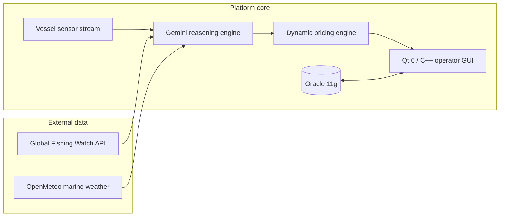

  

  
  
  
  

  

---

## About

Third-year AI engineering student at **ESPRIT School of Engineering** (Tunisia, class of 2027). I combine object-oriented software engineering, data systems, and applied AI to build reliable, production-minded software.

- Building **LifeLink**, a blood-donation logistics platform (Django)
- Chaining LLMs with live data sources for grounded, schema-driven reasoning
- Competing in algorithmic programming contests (TCPC 2026, INSAT Winter Cup)
- Looking for **AI and data engineering** internships and opportunities

---

## Featured Projects

| Project | Summary | Stack |
| :-- | :-- | :-- |
| **DataDock** Smart fishing port management | Desktop platform with role-based access (3 user tiers) and traceability for 15+ vessels. Dynamic pricing engine chaining Gemini with live weather and fishing-activity data, plus a contextual chatbot and CRUD dashboards. |     |
| **LifeLink** Blood donation coordination | Web platform connecting blood banks, donors, collection centres, and clinics. Focus on blood-unit traceability, automated urgency matching, and appointment workflows. *In active development.* |    |
| **Olist Analytics** E-commerce BI and ML | Data warehouse staging architecture for 100,000+ orders, with ETL cleaning and dimensional modeling. Supervised and unsupervised models for customer behavior analysis. |    |
| **Paxora Kids** EdTech storefront | Owned the backend finance module: relational MySQL schema and PHP CRUD APIs for a 20+ SKU store. Stripe payment simulation and Leaflet.js pickup map. Built in a 4-person Agile team. |     |

> DataDock and Paxora Kids are academic team projects hosted in private faculty repositories.

<b>DataDock architecture</b>

- **Architecture:** MVC in C++ with Qt; signals and slots for asynchronous API polling.
- **Database:** Oracle 11g schemas with triggers, sequence-generated keys, and transactional safety.
- **Security:** authentication and privilege checks across Port Master, Fleet Operator, and Market Analyst roles.

<b>LifeLink details</b>

- **Logistics:** cold-chain tracking for blood units, with status indicators and expiration countdowns.
- **Matching:** pairs rare blood requests with nearby available donors.
- **Process:** bi-weekly Agile Scrum sprints, protected branches, and code review.

<b>Olist Analytics details</b>

- **ETL:** cleaned heterogeneous CSVs into staging tables, handling foreign keys and null values.
- **Modeling:** customer lifetime value regression and RFM segmentation with scikit-learn.

<b>Paxora Kids details</b>

- **Finance:** transactional consistency for order totals, taxes, and simulated Stripe webhooks.
- **Maps:** interactive partner pickup locations with custom Leaflet.js markers.

---

## Technical Skills

| Area | Technologies |
| :-- | :-- |
| **Languages** | Python · C++ · C · JavaScript · PHP · SQL · Bash · HTML/CSS · LaTeX |
| **AI and ML** | Google Gemini API · LLM orchestration · scikit-learn · Machine Learning · Deep Learning · Pandas · NumPy · Matplotlib · Jupyter · Google Colab |
| **Data** | Oracle 11g · MySQL · SQLite · Data warehousing · ETL pipelines · Business intelligence · Data modeling |
| **Frameworks** | Django · Qt 6 / Qt Creator · SDL 1.2 · Bootstrap 5 · Leaflet.js |
| **APIs** | REST · Stripe · OpenMeteo · Global Fishing Watch · Postman |
| **Tooling** | Git · GitHub · VS Code · Linux · Agile Scrum |

---

## Achievements

| | |
| :-- | :-- |
| **TCPC 2026** | 30th of 96+ teams, and 1st among private engineering schools in Tunisia |
| **INSAT Winter Cup 2025–2026** | Top 12 of 60+ teams |
| **Academics** | 16.12/20 average, and 19.25/20 on an advanced C++ object-oriented project |

---

## Experience

**Educational Content Contributor and Front-End Support** · TAGEUP · *Apr – Sep 2026*
Structured online TAGE MAGE learning curricula and contributed core front-end features to the web platform.

**IT Engineering Intern** · CTAMA Assurances · *Summer 2024*
Technical support in an enterprise environment: IT maintenance, database queries, and system operations.

## Education

**Engineering Cycle, Artificial Intelligence** · ESPRIT School of Engineering · *Expected 2027*

## Languages

Arabic (native) · French (fluent) · English (full professional) · Spanish (A1)

---

## Working Principles

- **Disciplined design:** strict typing, defensive input handling, and clean OO patterns before added complexity.
- **Grounded AI:** LLMs tied to structured schemas and verified data, with robust fallback logic.
- **Team hygiene:** feature branches, atomic commits, clear relational modeling, Agile delivery.

  

