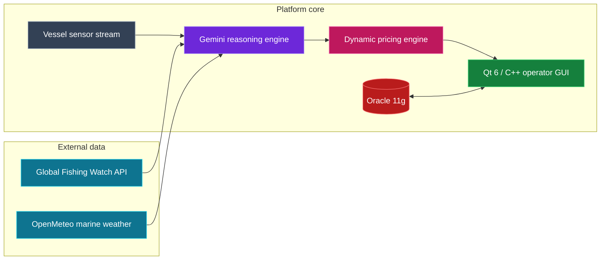

  

  
  
  
  

  

---

## 👋 About

AI engineering student at **ESPRIT School of Engineering** (Tunisia, **class of 2029**). I combine object-oriented software engineering, data systems, and applied AI to build reliable, production-minded software.

- 🩸 Building **LifeLink**, a blood-donation logistics platform (Django)
- 🧠 Chaining LLMs with live data sources for grounded, schema-driven reasoning
- 🏆 Competing in algorithmic contests (TCPC 2026, INSAT Winter Cup)
- 🚀 Looking for **AI and data engineering** internships and opportunities

---

## 🚀 Featured Projects

| Project | Summary | Stack |
| :-- | :-- | :-- |
| 🐟 **DataDock** Smart fishing port management | Desktop platform with role-based access (3 user tiers) and traceability for 15+ vessels. Dynamic pricing engine chaining Gemini with live weather and fishing-activity data, plus a contextual chatbot and CRUD dashboards. |     |
| 🩸 **LifeLink** Blood donation coordination | Web platform connecting blood banks, donors, collection centres, and clinics. Focus on blood-unit traceability, automated urgency matching, and appointment workflows. *In active development.* |    |
| 🛒 **Olist Analytics** E-commerce BI and ML | Data warehouse staging architecture for 100,000+ orders, with ETL cleaning and dimensional modeling. Supervised and unsupervised models for customer behavior analysis. |    |
| 🧸 **Paxora Kids** EdTech storefront | Owned the backend finance module: relational MySQL schema and PHP CRUD APIs for a 20+ SKU store. Stripe payment simulation and Leaflet.js pickup map. Built in a 4-person Agile team. |     |

> 🔒 DataDock and Paxora Kids are academic team projects hosted in private faculty repositories.

<b>🐟 DataDock architecture</b>

- **Architecture:** MVC in C++ with Qt; signals and slots for asynchronous API polling.
- **Database:** Oracle 11g schemas with triggers, sequence-generated keys, and transactional safety.
- **Security:** authentication and privilege checks across Port Master, Fleet Operator, and Market Analyst roles.

<b>🩸 LifeLink details</b>

- **Logistics:** cold-chain tracking for blood units, with status indicators and expiration countdowns.
- **Matching:** pairs rare blood requests with nearby available donors.
- **Process:** bi-weekly Agile Scrum sprints, protected branches, and code review.

<b>🛒 Olist Analytics details</b>

- **ETL:** cleaned heterogeneous CSVs into staging tables, handling foreign keys and null values.
- **Modeling:** customer lifetime value regression and RFM segmentation with scikit-learn.

<b>🧸 Paxora Kids details</b>

- **Finance:** transactional consistency for order totals, taxes, and simulated Stripe webhooks.
- **Maps:** interactive partner pickup locations with custom Leaflet.js markers.

---

## 🛠️ Technical Skills

**Languages**

**AI and Machine Learning**

**Data and Databases**

**Frameworks and APIs**

**Tooling**

---

## 🏆 Achievements

<table width="100%">
  <tr>
    <td width="33%" align="center">
        
      <b>30th of 96+ teams</b> 
      1st among private engineering schools in Tunisia
    </td>
    <td width="33%" align="center">
        
      <b>Top 12 of 60+ teams</b> 
      2025–2026 season
    </td>
    <td width="33%" align="center">
        
      <b>16.12 / 20 average</b> 
      19.25 / 20 on an advanced C++ OO project
    </td>
  </tr>
</table>

---

## 💼 Experience

**Educational Content Contributor and Front-End Support** · TAGEUP · 
Structured online TAGE MAGE learning curricula and contributed core front-end features to the web platform.

**IT Engineering Intern** · CTAMA Assurances · 
Technical support in an enterprise environment: IT maintenance, database queries, and system operations.

## 🎓 Education

**Engineering Cycle, Artificial Intelligence** · ESPRIT School of Engineering · 

## 🌐 Languages

---

## 🧭 Working Principles

- 🏗️ **Disciplined design:** strict typing, defensive input handling, and clean OO patterns before added complexity.
- 🧠 **Grounded AI:** LLMs tied to structured schemas and verified data, with robust fallback logic.
- 🤝 **Team hygiene:** feature branches, atomic commits, clear relational modeling, Agile delivery.

  

