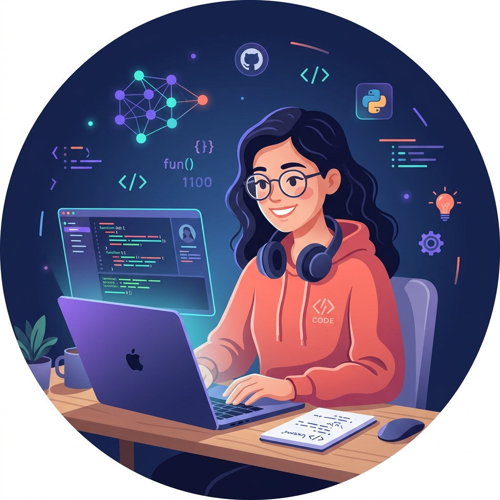

### Hi there, I'm Emna 👋

## AI Engineering Student & Software Developer 🚀

Third-year engineering student specializing in **Artificial Intelligence** at **ESPRIT School of Engineering** (Tunisia). I build robust, data-driven applications by coupling solid object-oriented software engineering foundations with modern AI capabilities—including LLM orchestration, intelligent agent workflows, and data pipelines.

---

# 💫 About Me:
- 🎓 **Engineering Cycle:** Specializing in Artificial Intelligence at ESPRIT (Academic Average: **16.12/20**, C++ Project: **19.25/20**).
- 🔭 **Current Project:** Architecting **LifeLink**, a Django-based coordination platform for blood donation and unit traceability.
- 🧠 **AI & LLM Integration:** Building dynamic systems using **Gemini API**, structured tool-use, and external API chaining (OpenMeteo, Global Fishing Watch).
- 📊 **Data & Analytics:** Designing BI staging areas, data warehouses, and training predictive models on real-world datasets (Olist e-commerce).
- 🏆 **Competitive Programming:** Active competitor — **TCPC 2026** (30th/96+ teams, **1st** among private engineering schools) & **INSAT Winter Cup 2025–2026** (Top 12).
- 💬 **Ask Me About:** C++, Qt, Python, Django, database modeling, and applied LLM workflows.

---

## 🌐 Connect With Me:

  
  
  

---

# 💻 Tech Stack:

### 🔹 Programming Languages

  
  
  
  
  
  
  

### 🔹 AI, Machine Learning & APIs

  
  
  
  
  

### 🔹 Databases & Data Modeling

  
  

### 🔹 Frameworks & Development Tools

  
  
  
  
  
  
  

---

# 🚀 Featured Projects:

### 🐟 DataDock — Smart Fishing Port Management Platform
> Collaborative desktop management platform designed to automate port operations, vessel monitoring, and market pricing intelligence.
- **Role & Architecture:** Architected the Fishing Management module with role-based access for 3 distinct user profiles and full fleet traceability covering 15+ vessels.
- **AI & API Chaining:** Engineered a dynamic market pricing engine by chaining Google Gemini LLM with live OpenMeteo weather data and Global Fishing Watch marine traffic streams.
- **Features:** Built interactive contextual AI chat assistance, real-time analytics, and comprehensive CRUD dashboards in an Agile 4-person team.
- **Stack & Status:**
  
  
  
  
  
  -lightgrey?style=flat-square&logo=git)

### 🩸 LifeLink — Blood Donation Coordination Platform
> Web coordination platform connecting blood banks, volunteer donors, collection centres, hospitals, and logistical units.
- **Objective:** Streamline the blood donation lifecycle with end-to-end blood-unit traceability, urgency matching, and donor scheduling.
- **Architecture:** Developing modular backend services and secure user role flows using Django, SQLite/MySQL, and Scrum Agile methodology.
- **Stack & Status:**
  
  
  
  
  

### 🛒 Olist — Brazilian E-Commerce Analytics & Machine Learning
> Comprehensive Business Intelligence, data warehousing, and machine learning pipeline applied to 100k+ Brazilian e-commerce orders.
- **Data Engineering:** Designed staging area workflows, multi-dimensional schemas, and ETL routines to consolidate customer, order, and seller dimensions.
- **Applied ML:** Implemented supervised regression/classification and unsupervised customer segmentation models using Google Colab.
- **Stack & Status:**
  
  
  
  
  

### 🧸 Paxora Kids — EdTech Platform
> Educational e-commerce and learning storefront tailored for children and educational institutions.
- **Finance & Inventory:** Engineered backend finance and inventory management module handling a 20+ SKU storefront with custom MySQL schemas and PHP CRUD APIs.
- **Integrations:** Integrated Stripe API payment gateway simulation and interactive location mapping with Leaflet.js within an Agile team.
- **Stack & Status:**
  
  
  
  
  
  -lightgrey?style=flat-square&logo=git)

---

# 🏆 Honors & Achievements:
- 🥇 **TCPC 2026 (Tunisian Collegiate Programming Contest):** **30th place** overall out of 96+ elite university teams & **1st place** among all participating private engineering schools.
- 🥈 **INSAT Winter Cup 2025–2026:** Top 12 finalist among 60+ competitive programming teams.
- 🎯 **Academic Excellence (ESPRIT):** Overall academic average **16.12/20** | C++ Advanced OOP Project Grade **19.25/20**.

---

# 📊 GitHub Stats:

   
   
  

## 🏆 GitHub Trophies

  

### ✍️ Random Dev Quote

  

### 🐍 GitHub Contribution Snake

  <picture>
    <source media="(prefers-color-scheme: dark)" srcset="https://raw.githubusercontent.com/emna-benothman/emna-benothman/output/github-snake-dark.svg" />
    <source media="(prefers-color-scheme: light)" srcset="https://raw.githubusercontent.com/emna-benothman/emna-benothman/output/github-snake.svg" />
    
  </picture>

---

  <i>Designed with focus, curiosity, and code by <b>Emna Ben Othman</b></i>

