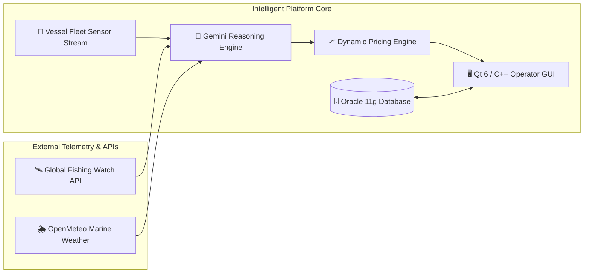

<!-- Header Banner -->
<p align="center">
  
</p>

<!-- Live Animated Typing Headline -->
<p align="center">
  <a href="https://github.com/emna-benothman">
    
  </a>
</p>

<!-- Identity & Overview -->
<div align="center">
  <p>
    Third-year engineering student specializing in <b>Artificial Intelligence</b> at <b>ESPRIT School of Engineering</b> (Tunisia).<br />
    Bridging <b>object-oriented software engineering</b>, <b>data systems</b>, and <b>applied artificial intelligence</b> to build reliable, production-minded solutions.
  </p>
  <p>
    📍 <i>Ariana, Tunisia</i> &nbsp;•&nbsp; 🎓 <i>AI Engineering Cycle ('27)</i> &nbsp;•&nbsp; 🏆 <i>Competitive Programmer (TCPC '26)</i>
  </p>

  <p>
    <a href="https://linkedin.com/in/emna-benothman" target="_blank">
      
    </a>
    &nbsp;
    <a href="https://github.com/emna-benothman" target="_blank">
      
    </a>
    &nbsp;
    <a href="mailto:emna.benothman@esprit.tn">
      
    </a>
    &nbsp;
    
  </p>
</div>

---

## 🖥️ System Environment & Station Status

```bash
emna@station:~$ neofetch --profile
  █████████   User: Emna Ben Othman
  ███   ███   Host: ESPRIT AI Engineering Station
  ███   ███   Track: Artificial Intelligence & Autonomous Systems (Year 3)
  █████████   Kernel: C++20 • Python 3.12 • Qt 6 • Django • Oracle 11g
  ███         AI Engines: Gemini API • LLM Chaining • Scikit-Learn
  ███         Algorithms: TCPC 2026 (30th/96+ & 1st Private) • INSAT Cup (Top 12)
  ███         Current Mission: Building LifeLink (Blood Logistics Platform)
  ███         Status: Open to AI & Data Engineering Opportunities 🚀
```

---

## 🎯 Engineering Philosophy

<table width="100%" border="0" cellpadding="10" cellspacing="0">
  <tr>
    <td width="33%" valign="top">
      <h4>🏗️ Architectural Discipline</h4>
      <p>Strict typing, defensive input handling, and clean Object-Oriented design patterns before adding unnecessary complexity.</p>
    </td>
    <td width="33%" valign="top">
      <h4>🧠 Grounded Intelligence</h4>
      <p>Moving beyond simple wrappers—grounding LLMs in structured schemas, verified external data streams, and robust fallback logic.</p>
    </td>
    <td width="33%" valign="top">
      <h4>🤝 Collaborative Hygiene</h4>
      <p>Feature-branch Git workflows, atomic commits, clear relational schema modeling, and Agile Scrum delivery.</p>
    </td>
  </tr>
</table>

---

## 🛠️ Technical Arsenal

### 💻 Programming Languages & Core Foundations
<p align="left">
  
  
  
  
  
  
  
  
  
  
  
</p>

### 🧠 Artificial Intelligence, Machine Learning & Data Science
<p align="left">
  
  
  
  
  
  
  
  
  
  
</p>

### 🗄️ Databases, Data Engineering & Warehousing
<p align="left">
  
  
  
  
  
  
  
  
</p>

### ⚙️ Frameworks, GUI & Frontend Development
<p align="left">
  
  
  
  
  
  
</p>

### 🌐 APIs, Web Integrations & Protocols
<p align="left">
  
  
  
  
  
</p>

### 🛠️ Developer Tools, Systems & Engineering Workflows
<p align="left">
  
  
  
  
  
</p>

---

## 📂 Engineering Portfolio & Flagship Systems

### 🐟 System Spotlight: DataDock System Architecture



<table width="100%">
  <tr>
    <td width="50%" valign="top">
      <h3>🐟 DataDock — Smart Fishing Port Management</h3>
      <p><b>Collaborative C++ / Qt / Oracle Desktop Platform</b></p>
      <ul>
        <li>Architected the Fishing Management module with role-based access control (3 user tiers) and fleet traceability across 15+ vessels.</li>
        <li>Engineered a dynamic pricing engine by chaining <b>Google Gemini API</b> with live <b>OpenMeteo</b> weather data and <b>Global Fishing Watch</b> streams.</li>
        <li>Built an intelligent contextual chatbot and real-time operational CRUD dashboards.</li>
      </ul>
      <p>
        
        
        
        
      </p>
      <details>
        <summary><b>🔍 Inspect Technical Details</b></summary>
        <p>
          • <b>Architecture:</b> MVC pattern in C++ with Qt framework, custom signals and slots for asynchronous API polling.<br />
          • <b>Database:</b> Relational Oracle 11g schemas with triggers, sequence-generated keys, and ACID transaction safety.<br />
          • <b>Security:</b> User authentication and privilege checking distinguishing Port Master, Fleet Operator, and Market Analyst roles.
        </p>
      </details>
      <p><i>🔒 Academic Team Project (Private Faculty Repo)</i></p>
    </td>
    <td width="50%" valign="top">
      <h3>🩸 LifeLink — Blood Donation Coordination</h3>
      <p><b>Django / Python Healthcare Logistics Platform</b></p>
      <ul>
        <li>Designing an end-to-end web coordination ecosystem connecting regional blood banks, donors, collection centres, and emergency clinics.</li>
        <li>Focused on blood-unit traceability, automated urgency matching, and donor appointment workflows.</li>
        <li>Built with Django's modular architecture following Agile Scrum principles.</li>
      </ul>
      <p>
        
        
        
        
      </p>
      <details>
        <summary><b>🔍 Inspect Technical Details</b></summary>
        <p>
          • <b>Logistics:</b> Cold-chain tracking for perishable blood units with status indicators and expiration countdowns.<br />
          • <b>Matching Engine:</b> Algorithmic matching pairing rare blood requests with proximity-based active donor availability.<br />
          • <b>Methodology:</b> Bi-weekly Agile Scrum sprints with Git branch protection and continuous code reviews.
        </p>
      </details>
      <p><i>🚀 In Active Engineering & Development</i></p>
    </td>
  </tr>
  <tr>
    <td width="50%" valign="top">
      <h3>🛒 Olist — Brazilian E-Commerce Analytics</h3>
      <p><b>BI, Data Warehousing & Applied Machine Learning</b></p>
      <ul>
        <li>Modeled and built a multidimensional data warehouse staging architecture for 100,000+ commercial order records.</li>
        <li>Implemented ETL cleaning routines and dimension-modeling schemas for consumer behavior analytics.</li>
        <li>Executed supervised classification/regression and unsupervised clustering models inside Google Colab environments.</li>
      </ul>
      <p>
        
        
        
        
      </p>
      <details>
        <summary><b>🔍 Inspect Technical Details</b></summary>
        <p>
          • <b>ETL Pipeline:</b> Cleaned raw heterogeneous CSVs into structured staging tables, managing foreign key consistency and null values.<br />
          • <b>Modeling:</b> Built customer lifetime value regression models and RFM (Recency, Frequency, Monetary) customer segmentation using scikit-learn.
        </p>
      </details>
      <p><i>📊 Analytics & ML Exploration Workspace</i></p>
    </td>
    <td width="50%" valign="top">
      <h3>🧸 Paxora Kids — EdTech Platform</h3>
      <p><b>Full-Stack PHP, MySQL & Stripe Commercial Engine</b></p>
      <ul>
        <li>Owned and implemented the backend finance module, designing relational MySQL schemas and PHP CRUD APIs for a 20+ SKU storefront.</li>
        <li>Integrated Stripe API payment simulation and location mapping using Leaflet.js.</li>
        <li>Collaborated within a 4-person Agile team leveraging Git branch protection and feature workflows.</li>
      </ul>
      <p>
        
        
        
        
      </p>
      <details>
        <summary><b>🔍 Inspect Technical Details</b></summary>
        <p>
          • <b>Finance Engine:</b> Handled transactional consistency for order totals, tax calculations, and Stripe webhooks simulation.<br />
          • <b>Cartography:</b> Embedded interactive partner pickup locations via Leaflet.js with custom coordinate markers.
        </p>
      </details>
      <p><i>🔒 Academic Team Project (Private Faculty Repo)</i></p>
    </td>
  </tr>
</table>

---

## 🏆 Competitive Programming & Academic Honors

<table width="100%" border="0" cellpadding="8">
  <tr>
    <td width="33%" align="center">
      <h3>🥇 TCPC 2026</h3>
      <p><b>30th Place / 96+ Teams</b><br /><b>1st Place</b> among all participating private engineering schools in Tunisia</p>
    </td>
    <td width="33%" align="center">
      <h3>🥈 INSAT Winter Cup</h3>
      <p><b>Top 12 Finalist</b><br />Ranked among top 12 teams out of 60+ competitive programming squads (2025–2026)</p>
    </td>
    <td width="33%" align="center">
      <h3>🎯 Academic Track</h3>
      <p><b>16.12 / 20</b> Academic Average<br /><b>19.25 / 20</b> in Advanced C++ Object-Oriented Project</p>
    </td>
  </tr>
</table>

---

## 📊 GitHub Analytics Hub

<!-- Unified Side-by-Side Stats Dashboard -->
<table align="center" border="0" cellpadding="0" cellspacing="4">
  <tr>
    <td valign="top" align="center">
      
    </td>
    <td valign="top" align="center">
      
    </td>
  </tr>
  <tr>
    <td colspan="2" align="center">
      
    </td>
  </tr>
</table>

<!-- GitHub Trophies -->
<p align="center">
  
</p>

<!-- Footer Wave Banner -->
<p align="center">
  
</p>
